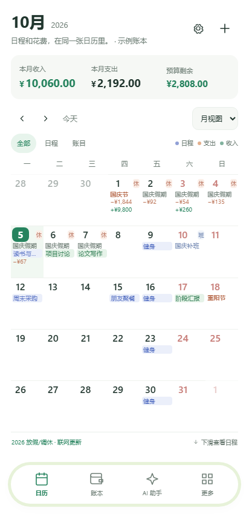
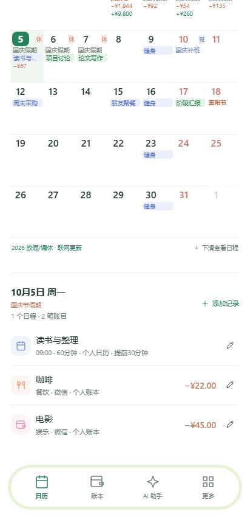
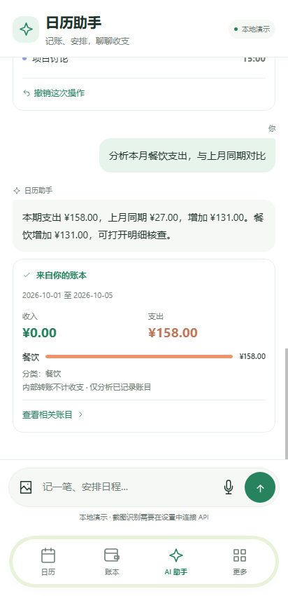

# 日历账本 AI · CalendarLedgerAI

**把日程、收支和 AI 助手放进同一张日历。**

CalendarLedgerAI 是一款面向 Android 的个人日程与记账应用。在日历中同时查看安排和每日收支，通过文字、普通话语音或消费截图与 AI 交互，完成记账、日程管理、信息查询和收支分析。日历和基础账本无需联网即可使用；自由对话与图片理解需自行配置可用的 AI 接口。

当前公开版本为 **v0.2.3 预览版**，支持 Android 8.0 及以上，无需 Root。应用独立实现并维护，不包含 Fossify Calendar 的源码。

[**下载 Android APK**](https://github.com/han1143437811-cmd/CalendarLedgerAI/releases/download/v0.2.3/CalendarLedgerAI-v0.2.3.apk) · [版本与源码](https://github.com/han1143437811-cmd/CalendarLedgerAI/releases/tag/v0.2.3) · [安装指南](dist/手机安装说明.md)

## 界面预览

<p>
  
  
  
</p>

<sub>截图为示例数据。日历截图来自 v0.2.3 布局，AI 对话截图展示沿用的界面。</sub>

## 主要功能

**📅 日历与日程**

月、周、日视图集中展示日程、每天的收入与支出、中国传统节日及法定节假日。支持日程提醒、待办事项、每日/每周/每月重复，以及按工作日空档安排任务。月视图优先展示整月概览，点选日期后可向下滚动查看详情。

**💰 本地记账与统计**

管理收入、支出、退款、转账、分类、账户和多个账本；可新增、修改、删除、筛选与撤销操作。收支统计在本地按整数“分”计算，支持按日期、类别或账本分析，也可与上月同期比较。支持 CSV 导出和 JSON 备份。

**🤖 AI 助手**

可以通过自然语言要求助手新增或修改账目、管理日程、查找空档、分析收支和调整部分设置。助手通过应用提供的工具执行操作，分析结果基于本地计算数据。使用自由对话需自行配置 DeepSeek 或兼容 Chat Completions 的服务；不配置 API 时可使用有限中文指令的本地演示。

**🖼️ 截图与照片辅助录入**

在 AI 对话中最多选择三张图片，使用支持图像理解及工具调用的模型提取候选账目或日程，并生成可编辑的核对卡片。**识别内容不会直接写入账本**，需要检查并确认保存。识别结果的准确性取决于所配置的模型与图片质量。

**🎙️ 普通话离线语音输入**

APK 内置 Vosk 普通话模型，语音在设备上转为可修改的文字草稿。核对后再发送给助手，不会自动记账，也无需上传录音至 AI 服务。

**🎨 使用体验**

提供浅色与深色界面、大字显示、离线农历节日，以及从公开数据镜像更新中国节假日及调休安排。尚未公布的年份不会自行推测假期。

## 安装与快速开始

1. 下载并安装 [CalendarLedgerAI v0.2.3 APK](https://github.com/han1143437811-cmd/CalendarLedgerAI/releases/download/v0.2.3/CalendarLedgerAI-v0.2.3.apk)。包名为 `org.calendarledger.preview`；已安装同签名试用版时可覆盖更新。卸载或清除数据前请先备份。
2. 首次打开可使用示例账本体验日历、记账和本地演示指令。开始记录真实数据前，建议导出备份并清空示例内容。
3. 需要自由 AI 对话或截图理解时，进入 **更多 → AI 与设置**，填写实际可用的 API 地址、模型名称和 API Key，测试连接后保存。
4. 在 **AI 助手** 页面输入文字、选择图片，或点击麦克风生成普通话文字草稿。保存图片识别卡片前，请仔细核对金额、日期和分类。

APK 约 **49.2 MiB**，内置语音模型首次准备还会占用额外本地存储。详细步骤、权限及问题排查参见 [手机安装说明](dist/手机安装说明.md)。

## 数据、隐私与联网

账目、日程和应用数据默认保存在设备本地。Android 端 API Key 使用 **Android Keystore 与 AES-GCM** 加密保存，不包含在业务备份中。离线语音识别不上传音频。

使用远程 AI 时，当前对话、执行任务所需的账目或日程上下文，以及主动选取的图片会发送至用户配置的 API 服务，可能产生费用。节假日联网更新使用 [NateScarlet/holiday-cn](https://github.com/NateScarlet/holiday-cn) 的公开数据镜像；未联网时仍可使用已缓存或内置的数据。

## 当前范围与验证

这是一个**功能预览版本**，不是已完成所有适配的正式产品。当前不支持系统日历同步、桌面小组件、自动读取微信或支付宝流水、账户余额和跨设备同步，也没有集成 Fossify Calendar 源码。

v0.2.3 在 **2026-10-05** 完成的检查包括 **35 项浏览器检查和 30 项 Android 16 模拟器检查**，涵盖主要布局、日历滚动、节日显示、聊天界面及已有数据覆盖升级等流程。

**尚未验证**：三星 S24 Ultra / One UI 8.5 真机上的完整表现、有效 DeepSeek Key 下的模型交互质量，以及该版本的完整真实语音使用体验。模拟器检查和模拟 API 返回不能代替这些验证。具体结果见 [验证报告](dist/验证结果-v0.2.3.json)；各版本的技术变更记录见 [开发历史](docs/DEVELOPMENT_HISTORY.md)。

## 开发与构建

项目包含浏览器预览和 Android WebView 应用，核心界面与业务逻辑位于 `prototype/`，Android 入口及原生桥接位于 `android/`。

浏览器本地预览需要 **Node.js 20+**：

```powershell
cd prototype
node server.mjs
```

启动后在电脑浏览器访问 `http://127.0.0.1:8788`。运行业务测试：

```powershell
cd prototype
node --test tests/*.test.mjs
```

构建 Android APK 还需 **Python 3、JDK 21 和 Android SDK**，Windows PowerShell 下可参考以下步骤：

```powershell
powershell -NoProfile -ExecutionPolicy Bypass -File build-tools/setup-android.ps1
python build-tools/setup-voice.py
npm.cmd ci --prefix build-tools/js
# 先把 android/build.ps1 中的 JDK 路径改为本机的 JDK 21 路径
powershell -NoProfile -ExecutionPolicy Bypass -File android/build.ps1
```

自行构建使用的开发签名可能与 Release APK 不同，无法直接覆盖已发布安装包；请先备份需要保留的数据。

更多资料：[安装指南](dist/手机安装说明.md) · [版本说明](RELEASE_NOTES.md) · [开发历史](docs/DEVELOPMENT_HISTORY.md) · [参与贡献](CONTRIBUTING.md)

## 开源、参考与致谢

本项目独立实现的代码以 **GNU GPL v3.0** 开源，详见 [LICENSE](LICENSE)。随附的第三方依赖、数据与语音资源遵循各自的许可证，详见 [依赖及致谢](ACKNOWLEDGEMENTS.md) 与 [第三方许可声明](prototype/THIRD_PARTY_NOTICES.txt)。

特别感谢 **[Fossify Calendar](https://github.com/FossifyOrg/Calendar)** 的作者、维护者和开源贡献者。其开放、重视隐私的 Android 应用设计为本项目早期探索提供了重要参考。**CalendarLedgerAI 并非 Fossify Calendar 的分支，也未合并其源码或提交历史**；项目的功能实现、版本发布与问题反馈均独立维护。

欢迎通过 [GitHub Issues](https://github.com/han1143437811-cmd/CalendarLedgerAI/issues) 反馈问题或改进建议。

---

*CalendarLedgerAI is an independently implemented Android calendar, expense tracker, and optional AI assistant. Local calendar and ledger features work offline; AI services require user configuration. Thanks to the Fossify Calendar community for inspiration and reference.*
